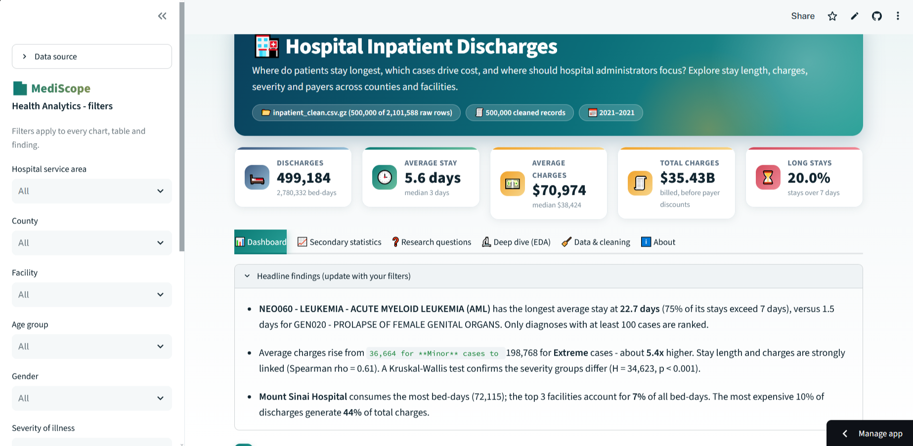
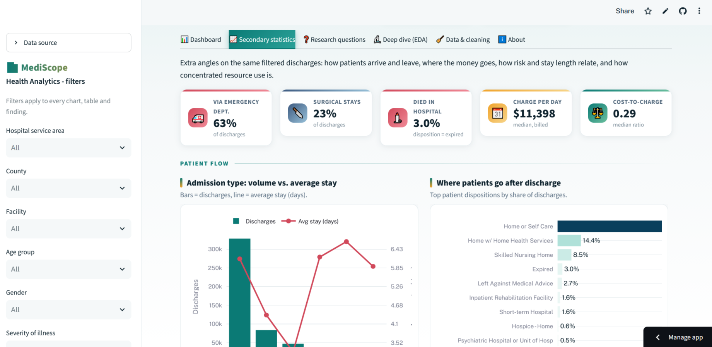
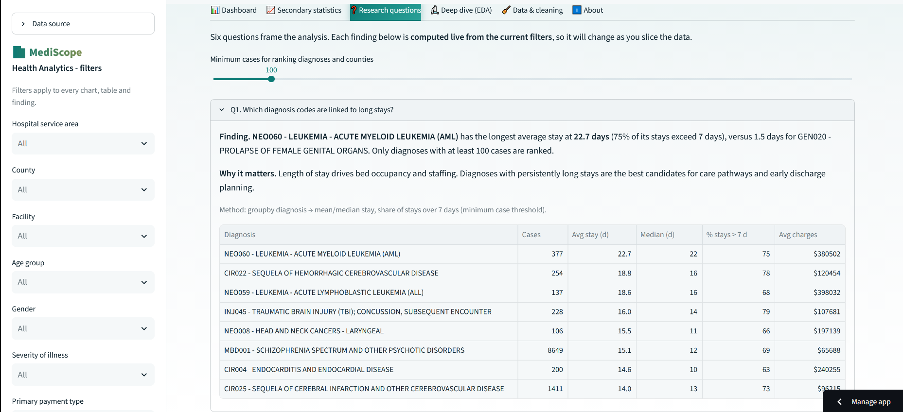
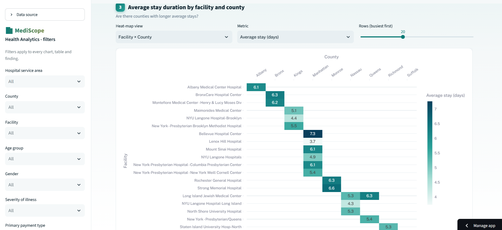
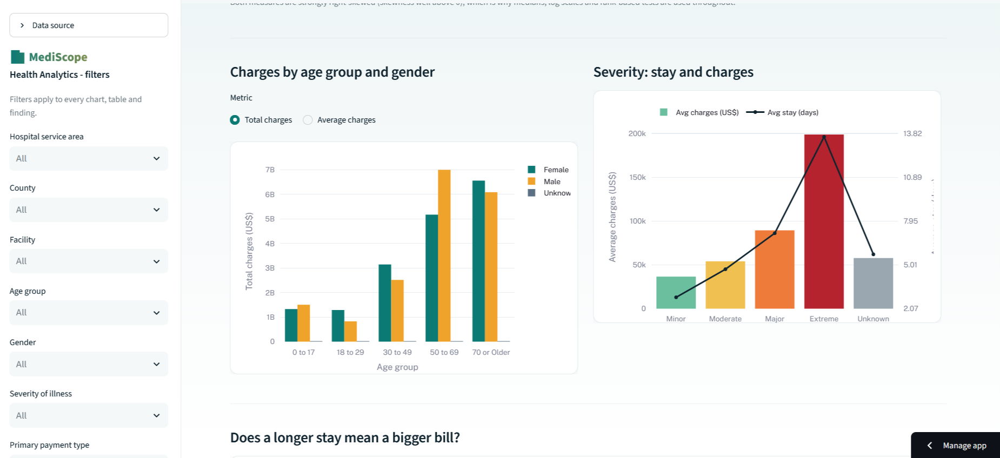
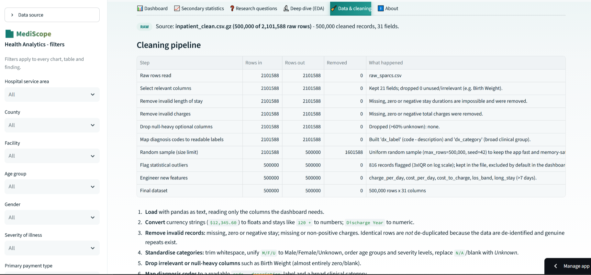

# 🏥 Hospital Inpatient Discharges Dashboard

### [Open the live dashboard](https://iadai201-ajeyaditya-1000406-aiy2-mathematics-for-ai-ii-sa.streamlit.app/)

| | |
| --- | --- |
| **Student** | A Jeyaditya |
| **Registration number** | 1000406 |
| **School** | Jain Vidyalaya |
| **CRS** | Artificial Intelligence |
| **Course** | Mathematics for AI-II |
| **CRS Facilitator** | Syed Ali Beema |
| **Assessment** | Summative Assessment, Scenario 2: Hospital Inpatient Discharges Dashboard |



---

## 1. Why I built this

Imagine you run operations at a busy hospital. Every discharge leaves behind a record: how long the patient stayed,
how sick they were, who paid, and what the hospital billed. Across a whole state, that adds up to millions of rows,
far too many to read, but full of answers to questions that matter:

- Which conditions keep patients in bed the longest?
- What really drives the cost of a stay?
- Do some counties or hospitals look very different from the rest?

In this project I play a data analyst at the fictional **MediScope Health Analytics**. My job was to take a real-world
style discharge dataset and build an interactive dashboard that a hospital administrator, clinician or operations
manager can use **without writing a line of code**.

---

## 2. What you can do with the dashboard

The app has six tabs:

| Tab | What it gives you |
| --- | --- |
| 📊 **Dashboard** | The five core charts (bar, box plot, heat-map, pie, histogram), headline KPIs and auto-generated findings |
| 📈 **Secondary statistics** | 11 further charts: admission types, discharge destinations, severity vs. mortality risk, a charges treemap, charges vs. costs by payer, cost concentration and more |
| ❓ **Research questions** | Plain-English answers to six business questions, **recalculated live** from whatever filters you choose |
| 🔬 **Deep dive (EDA)** | Distribution statistics, correlation and significance tests, pivot tables and trends |
| 🧹 **Data & cleaning** | A step-by-step audit of how the raw data was cleaned (rows in, rows out) and a data dictionary |
| ℹ️ **About** | How to use the app, method notes and limitations |

A sidebar of filters (year, service area, county, facility, age, gender, severity, payer, admission type, length of stay,
and an outlier switch) controls **every** chart, KPI and written finding at once.

### IADAI201-AJeyaditya-1000406_AIY2_Mathematics_for_AI_II_SA/screenshots

| Dashboard | Secondary statistics | Research questions |
| --- | --- | --- |
|  |  |  |

| Heat-map | Deep dive | Data & cleaning |
| --- | --- | --- |
|  |  |  |

---

## 3. Step 1: Understanding the problem

### The data
The dataset is a de-identified hospital inpatient discharge file in the layout of New York State's **SPARCS**
(Statewide Planning and Research Cooperative System). Each row is one discharge:

| Group | Fields used |
| --- | --- |
| Patient | Age group, gender, race, ethnicity |
| Clinical | CCSR diagnosis code and description, APR severity of illness, risk of mortality, medical/surgical |
| Stay | Length of stay, type of admission, patient disposition, discharge year |
| Money | Total charges, total costs, primary payment type |
| Place | Hospital service area, county, facility |

### What I learned before writing any code
- **Length of stay** is the everyday measure of hospital efficiency. It decides bed availability, staffing and cost.
  It is also heavily skewed, because a few very long stays pull the average up, so I report medians and percentiles
  alongside means.
- **Severity of illness** (the APR-DRG scale: Minor → Extreme) is how hospitals fairly compare patients. Comparing
  costs without it is misleading.
- **Charges are not costs.** Charges are what a hospital bills; costs estimate what care actually consumed. I show both,
  plus the cost-to-charge ratio.
- **CCSR codes** (AHRQ's refined diagnosis categories, such as `CIR019`) group thousands of diagnoses into meaningful
  families. The three-letter prefix tells you the body system, which I use to build readable clinical categories.
- Healthcare spending tends to be **concentrated**: a small share of patients and facilities account for a large share of
  the bill. So I measure concentration directly.

### The six questions I set out to answer

| # | Question | Where to find the answer |
| --- | --- | --- |
| Q1 | Which diagnoses are linked to long stays? | Chart 1 · Research tab |
| Q2 | Which age groups incur the highest charges? | Deep dive · Research tab |
| Q3 | How does patient severity affect total cost? | Chart 2 · Deep dive · Research tab |
| Q4 | Are there counties with longer average stays? | Chart 3 · Deep dive · Research tab |
| Q5 | How do payment types affect the final billing? | Chart 4 · Secondary statistics · Research tab |
| Q6 | Which facilities show the highest utilisation? | Deep dive · Research tab |

---

## 4. Step 2: Cleaning the data

Real data is messy, and this file was no exception. All of the logic lives in [`src/processing.py`](src/processing.py)
(modular and commented), and the app shows the row counts for every step in its **Data & cleaning** tab.

| # | What I did | Why |
| --- | --- | --- |
| 1 | Read the file in chunks, detecting the delimiter and encoding automatically | The raw file is far too large to load in one go |
| 2 | Converted `"$12,345.60"` to a number and `"120 +"` to `120` | Charges and top-coded stays arrive as text |
| 3 | Removed records with missing, zero or **negative** stay length, and with missing or non-positive charges | These are impossible values |
| 4 | Standardised categories (M/F/U → Male/Female/Unknown, trimmed spaces, ordered age and severity levels, `N/A` → Unknown) | So groups don't split into near-duplicates |
| 5 | Dropped irrelevant or mostly empty columns such as Birth Weight, IDs, and secondary payment fields | Keeps the data lean and meaningful |
| 6 | Built readable diagnosis labels (`CIR019 - Heart failure`) and body-system categories from the CCSR code prefix | Raw codes are unreadable to administrators |
| 7 | Engineered new features: charge per day, cost per day, cost-to-charge ratio, stay-length bands, long-stay flag (> 7 days) | Richer analysis than the raw columns allow |
| 8 | Flagged extreme outliers (3×IQR on the log scale) for stay and charges | Excluded by default; one tick-box in the sidebar brings them back |

I deliberately did **not** drop duplicate rows: the data is de-identified, so identical rows can be genuinely different
patients.

> **A note on size.** The raw file has millions of rows and is too large for GitHub (100 MB per file) and for a free
> hosting server's memory. The app therefore works on a **uniform random sample of about 500,000 valid rows**. At that
> size the group averages and distributions are statistically indistinguishable from the full file. The exact row
> counts are shown in the *Data & cleaning* tab.

---

## 5. Step 3: What the analysis looks at

Implemented in [`src/analysis.py`](src/analysis.py) with `groupby().agg()` and `pivot_table()`:

- Average and median stay, and share of stays over a week, for each diagnosis (with a minimum-case rule so tiny groups
  don't distort rankings)
- Total, mean and median charges by age group and gender
- Charge multiple by severity compared with *Minor*, a Spearman rank correlation between stay and charges, and a
  Kruskal-Wallis test (suited to skewed data)
- County averages and facility utilisation ranked by **bed-days** (the sum of stay lengths)
- Payer mix, billing level and cost-to-charge ratio
- Pivot tables: region × payment type, age group × severity, facility × county
- Distribution statistics (skewness, percentiles) and how much of the total bill the top 10% of cases generate

### Key findings

> ✏️ **Fill in these numbers from the live app before submitting.** Open the **Research questions** tab with no filters
> and copy the figures into the right-hand column. Then delete this note.

| Question | What the data shows |
| --- | --- |
| **Q1** Long-stay diagnoses | [Name the diagnosis with the longest average stay, its average days, and the % of its stays over 7 days] |
| **Q2** Age and charges | [Which age group has the highest total charges, and which has the highest average bill] |
| **Q3** Severity and cost | [How many times more *Extreme* cases cost than *Minor* ones; the Spearman ρ between stay and charges] |
| **Q4** Counties | [County with the longest and shortest average stay, and the gap in days] |
| **Q5** Payment types | [Largest payer by share; payer with the highest and lowest average charges] |
| **Q6** Utilisation | [Facility with the most bed-days; share of bed-days in the top 3; share of charges from the top 10% of cases] |

**What this means for administrators:** discharge planning should start early for the long-stay diagnoses; budgets and
staffing should follow case mix (severity and age) rather than raw volume; unusually long county averages deserve a look at
local post-acute capacity before judging hospitals; and the few facilities and cases that carry most of the bed-days and
charges are the best place to focus improvement effort.

---

## 6. Step 4: The visualisations

**The five core charts**

| # | Chart | Type | What you can do |
| --- | --- | --- | --- |
| 1 | Average stay per diagnosis | Horizontal bar | Choose how many diagnoses and the minimum cases; bar colour tracks the stay length (hotter = longer) |
| 2 | Total charges by severity | Box plot | Switch between log and linear scale; mean shown as a dashed line |
| 3 | Average stay by facility and county | Heat-map | Four views, two metrics, adjustable number of rows |
| 4 | Patients by payment type | Donut | Switch between share of patients and share of total charges |
| 5 | Distribution of length of stay | Histogram | Cap the range, toggle log scale; mean and median marked |

**Beyond the five:** the *Secondary statistics* tab adds admission-type and discharge-destination charts, a
stay-length-by-severity mix, a severity vs. mortality-risk heat-map, a treemap of charges by clinical category, charges
vs. costs by payer, daily billing intensity, the top 10 diagnoses by total charges, a Lorenz-style concentration curve,
stay length by age group, admission mix by age, and an age/gender sunburst. The *Deep dive* tab adds a log-log scatter with
fitted trend line, county and facility rankings, pivot-table heat-maps and yearly trends.

**Design choices.** One consistent colour story: teal for volume and length, amber for money, crimson and red for risk and
long stays. A KPI strip stays visible on every tab, all filters live in one sidebar, and every chart has a short
plain-English caption.

---

## 7. How it all fits together

```
data/raw_sparcs.csv ──► src/processing.py  (chunked cleaning, runs once)
                              │
                              ▼
                data/inpatient_clean.csv.gz   ◄── cached clean data (what the deployed app reads)
                              │
                              ▼
        app.py  (filters · layout · charts) ──► src/analysis.py  (groupby · pivot · statistics)
```

| Component | Role |
| --- | --- |
| `app.py` | The Streamlit app: data loading with caching, sidebar filters, KPI strip, six tabs, all Plotly charts |
| `src/processing.py` | Column detection, cleaning, feature engineering, chunked loading and caching |
| `src/analysis.py` | Pure functions that turn the clean data into tables and statistics |
| `src/demo_data.py` | Synthetic data for tests and a clearly-labelled demo fallback |
| `prepare_data.py` | Optional command-line tool to build the cache with progress output |
| `tests/test_pipeline.py` | 13 automated tests for the cleaning and analysis code |
| `.streamlit/config.toml` | Theme and upload settings |

The app looks for data in this order: a file you upload in the sidebar → `data/raw_sparcs.csv` (cleaned once, then
cached) → the cached `data/inpatient_clean.csv.gz`. The deployed version uses the cached file, since the raw file is
too big for GitHub. If no data is found at all, it shows a visible "Demo mode" banner rather than a blank page.

---

## 8. Run it yourself

```bash
git clone <this-repository-url>
cd <repository-folder>
python -m venv .venv
source .venv/bin/activate          # Windows: .venv\Scripts\activate
pip install -r requirements.txt

# Optional: to rebuild from the raw data, place it at data/raw_sparcs.csv
streamlit run app.py
```

- The first start with a raw file cleans it in chunks (a few minutes for a very large file) and saves the cache.
  Later starts take seconds.
- To use **every** row locally: `MAX_ROWS=0 streamlit run app.py` (PowerShell: `$env:MAX_ROWS=0; streamlit run app.py`).
- To pre-build the cache with progress shown: `python prepare_data.py`.
- To run the tests: `python -m pytest -q` (or `python tests/test_pipeline.py`).

### Deploying on Streamlit Community Cloud
1. Make sure `data/inpatient_clean.csv.gz`, `data/cleaning_report.json` and `data/clean_meta.json` are in the repository
   (the raw file stays on your computer).
2. At [streamlit.io/cloud](https://streamlit.io/cloud), choose **Deploy an app**, select this repository and branch,
   and set the main file to `app.py`.
3. Click **Deploy**. Streamlit installs everything in `requirements.txt` automatically.
4. After pushing new data files or code, use **Reboot app** from the app's menu.

---

## 9. Repository layout

```
.
├── app.py                       # the dashboard
├── prepare_data.py              # optional: build the clean-data cache
├── requirements.txt
├── README.md
├── .streamlit/config.toml
├── src/
│   ├── processing.py            # cleaning and feature engineering
│   ├── analysis.py              # EDA and statistics
│   └── demo_data.py             # synthetic fallback and test data
├── data/
│   ├── inpatient_clean.csv.gz   # cleaned cache used by the deployed app
│   ├── cleaning_report.json     # row counts for every cleaning step
│   ├── clean_meta.json
│   └── README.md
├── tests/test_pipeline.py
├── IADAI201-AJeyaditya-1000406_AIY2_Mathematics_for_AI_II_SA/screenshots/                 # images used in this README
└── docs/research_notes.md       # background research and design decisions
```

---

## 10. Honest limitations

- **De-identified data.** No patient-level information is shown anywhere.
- **Charges are billed amounts**, not what insurers actually paid and not the true cost of care.
- **Association is not causation.** Differences between payers, counties or facilities partly reflect case mix such as
  age and severity.
- **Sample-based.** Results come from a random sample of about 500,000 discharges (see the note in Step 2).
- **Outliers.** Extreme records are excluded by default to keep averages meaningful; the sidebar switch includes them again.

---

## 11. References

- NYS Department of Health, *SPARCS*: <https://www.health.ny.gov/statistics/sparcs/>
- AHRQ HCUP, *Clinical Classifications Software Refined (CCSR)*: <https://hcup-us.ahrq.gov/toolssoftware/ccsr/ccs_refined.jsp>
- Streamlit blog, *Improving healthcare management with Streamlit*: <https://blog.streamlit.io/improving-healthcare-management-with-streamlit/>
- Plotly Express documentation: <https://plotly.com/python/plotly-express/>
- Streamlit documentation: <https://docs.streamlit.io/>
- pandas documentation (`groupby`, `pivot_table`): <https://pandas.pydata.org/docs/>

---

*Built by **A Jeyaditya** (Reg. No. 1000406), Jain Vidyalaya · CRS Facilitator: Syed Ali Beema ·
Mathematics for AI-II, Summative Assessment.*
